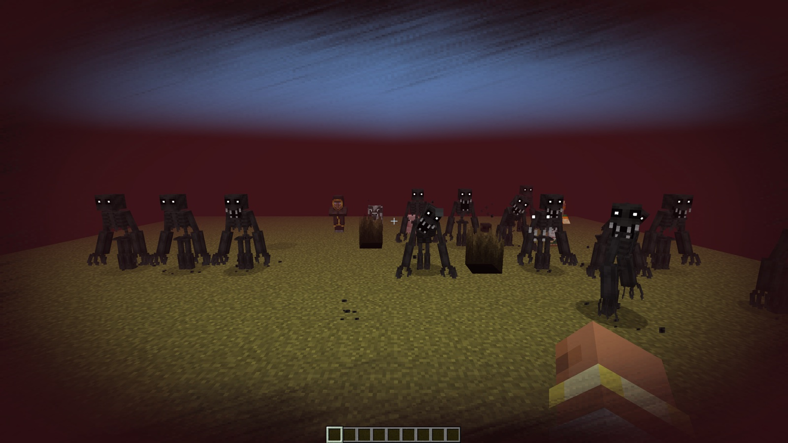
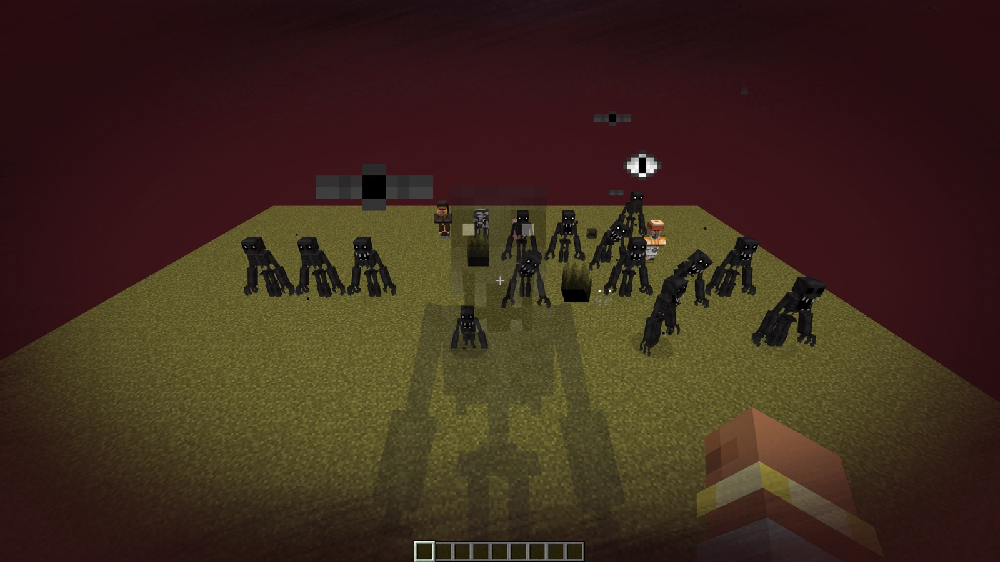

# The Midnight Lurker — NeoForge + Fabric 26.3

**Something is watching you at night. Don't look back.**

An unofficial port of **[The Midnight Lurker](https://www.curseforge.com/minecraft/mc-mods/the-midnight-lurker)** 3.3.7
by **Voxla** from Forge 1.20.1 to **NeoForge and Fabric 26.3**, with all of its content. Other Minecraft versions are on
the branches of this repository: `main` (1.21.1), `mc/1.21.11`, `mc/26.1.2`, `mc/26.2`, `mc/26.3`.

<b>🇬🇧 English — click to open</b>

## About

A horror mod: the Midnight Lurker stalks you at night, in caves and in the Nether. It comes in many forms — it watches
from a distance, hides underground until you look at it, runs away, turns its back, disguises itself as a villager, a
cow or a pig, or attacks without warning. Meeting it slowly drives you insane: an insanity bar, visual and sound
effects, jumpscares and amnesia, with void gateways and void hands on the way. The book "The Lurker's Insanity" from the
outcast villager tells you how to keep your mind.

## Installation

**NeoForge**
1. Install **NeoForge 26.3.0.97** or newer for Minecraft **26.3** (Java 25).
2. Put **[GeckoLib](https://modrinth.com/mod/geckolib)** (5.5.7 or newer, NeoForge 26.3) into `mods`.
3. Put `the-midnight-lurker-neoforge-3.3.7.1+26.3.jar` from the [releases](../../releases) into `mods`.

**Fabric**
1. Install **Fabric Loader 0.19.5** or newer for Minecraft **26.3** (Java 25) and **[Fabric API](https://modrinth.com/mod/fabric-api)** 0.164.0 or newer.
2. Put **[GeckoLib](https://modrinth.com/mod/geckolib)** (5.5.7 or newer, Fabric 26.3) into `mods`.
3. Put `the-midnight-lurker-fabric-3.3.7.1+26.3.jar` from the [releases](../../releases) into `mods`.

Needed on both the client and the server.

## Config

`config/midnightlurkerconfig.json` (the same file as in 3.3.7): spawn rates in the overworld and the Nether, cave and
Nether spawning, the void gateway rate, jumpscares and their sound, chase music, the insanity bar and its countdown,
amnesia, the shapeshifter disguises, whether the Lurker can be killed, whether it stays during the day and breaks
trapdoors. Changes are picked up within a second while the game runs.

## What changed in the port

The content and the behaviour are the same as in 3.3.7. Details: [PORTLOG.md](PORTLOG.md).

- **Less lag.** The Lurker's spawn checks searched for entities in areas 700–1000 blocks wide, many times per check,
  and the config file was read from disk in every check, every tick and every frame of the insanity bar (players
  reported lag, especially in the Nether: issues #23, #25 of the original). The port keeps the same results with a
  short list of the mod's entities and a config read once: the spawn checks are about 15 times faster, the client
  spends a third less time in the mod.
- 1.21 changes: player data is a NeoForge attachment, the book has no empty item inventory any more, the tough door
  takes any pickaxe (as before).
- 1.21.11: GeckoLib 5 (the same models and animations), spawn eggs keep their colors as textures, dropping the book
  closes its screen in multiplayer too. A few animations the original asks for but never had (the Faker watcher's
  idle, the Hider's swim) crash GeckoLib 5; the port skips them as GeckoLib 4 did, and the Faker watcher now idles.

## Languages

English · Русский · Українська · Deutsch · Español · Português (Brasil) — complete. Ukrainian and Brazilian Portuguese are
new in the port (not by native speakers). The original's French, Italian, Icelandic, Japanese, Dutch and Portuguese
(Portugal) translations are kept.

## License and credits

[LGPL-3.0-only](LICENSE). The original mod is MIT-licensed: its text and copyright are in
[licenses/LICENSE-MIT](licenses/LICENSE-MIT), and every file of the original keeps it. The Midnight Lurker, its art,
models, sounds and story: **Voxla**, with Whirlygig and Z3R0TW0 (made with MCreator). Port to NeoForge 1.21.1 – 26.3:
Vladeezyy. Please download the port only from its official pages.

<b>🇷🇺 Русский — нажмите, чтобы открыть</b>

## О моде

Хоррор-мод: Бабай (Midnight Lurker) преследует вас ночью, в пещерах и в Незере. У него много обличий — он наблюдает
издалека, прячется под землёй, пока вы на него не посмотрите, убегает, стоит спиной, притворяется жителем, коровой
или свиньёй или нападает без предупреждения. Встречи с ним постепенно сводят с ума: шкала безумия, искажения картинки
и звуки, скримеры и амнезия, а ещё врата пустоты и руки пустоты. Книга «Безумие Бабая» от жителя-изгоя подскажет, как
сохранить рассудок.

## Установка

**NeoForge**
1. Установите **NeoForge 26.3.0.97** или новее для Minecraft **26.3** (Java 25).
2. Положите **[GeckoLib](https://modrinth.com/mod/geckolib)** (5.5.7 или новее, NeoForge 26.3) в `mods`.
3. Положите `the-midnight-lurker-neoforge-3.3.7.1+26.3.jar` из [релизов](../../releases) в `mods`.

**Fabric**
1. Установите **Fabric Loader 0.19.5** или новее для Minecraft **26.3** (Java 25) и **[Fabric API](https://modrinth.com/mod/fabric-api)** 0.164.0 или новее.
2. Положите **[GeckoLib](https://modrinth.com/mod/geckolib)** (5.5.7 или новее, Fabric 26.3) в `mods`.
3. Положите `the-midnight-lurker-fabric-3.3.7.1+26.3.jar` из [релизов](../../releases) в `mods`.

Нужен и на клиенте, и на сервере.

## Настройки

`config/midnightlurkerconfig.json` (тот же файл, что в 3.3.7): частота спавна в обычном мире и в Незере, спавн в
пещерах и в Незере, частота врат пустоты, скримеры и их звук, музыка погони, шкала безумия и её таймер, амнезия,
маскировки под животных и жителя, можно ли убить Бабая, остаётся ли он днём и ломает ли люки. Изменения подхватываются
в течение секунды прямо в игре.

## Что изменилось в порте

Содержимое и поведение — как в 3.3.7. Подробности: [PORTLOG.md](PORTLOG.md).

- **Меньше лагов.** Проверки спавна Бабая искали сущности в областях шириной 700–1000 блоков по много раз за проверку,
  а конфиг читался с диска в каждой проверке, каждый тик и каждый кадр шкалы безумия (игроки жаловались на лаги,
  особенно в Незере: issues #23, #25 оригинала). Порт даёт тот же результат по короткому списку сущностей мода и
  читает конфиг один раз: проверки спавна примерно в 15 раз быстрее, клиент тратит на мод на треть меньше времени.
- Изменения 1.21: данные игрока — attachment NeoForge, у книги больше нет пустого инвентаря, крепкую дверь можно
  добыть любой киркой (как и раньше).
- 1.21.11: GeckoLib 5 (те же модели и анимации), яйца призыва сохранили цвета в виде текстур, выброшенная книга
  закрывает свой экран и в мультиплеере. Несколько анимаций, которые оригинал запрашивает, но которых нет в файлах
  (покой наблюдателя-обманщика, плавание прячущегося), роняют GeckoLib 5; порт пропускает их, как GeckoLib 4, а
  наблюдатель-обманщик теперь играет свою анимацию покоя.

## Языки

English · Русский · Українська · Deutsch · Español · Português (Brasil) — полностью. Украинский и бразильский
португальский добавлены в порте (переводы не от носителей). Французский, итальянский, исландский, японский,
нидерландский и португальский (Португалия) из оригинала сохранены.

## Лицензия и авторы

[LGPL-3.0-only](LICENSE). Оригинал под лицензией MIT: её текст и копирайт — в [licenses/LICENSE-MIT](licenses/LICENSE-MIT),
и все файлы оригинала остаются под ней. The Midnight Lurker, графика, модели, звуки и история: **Voxla**, вместе с
Whirlygig и Z3R0TW0 (сделано в MCreator). Порт на NeoForge 1.21.1 – 26.3: Vladeezyy. Пожалуйста, скачивайте порт только с его
официальных страниц.

